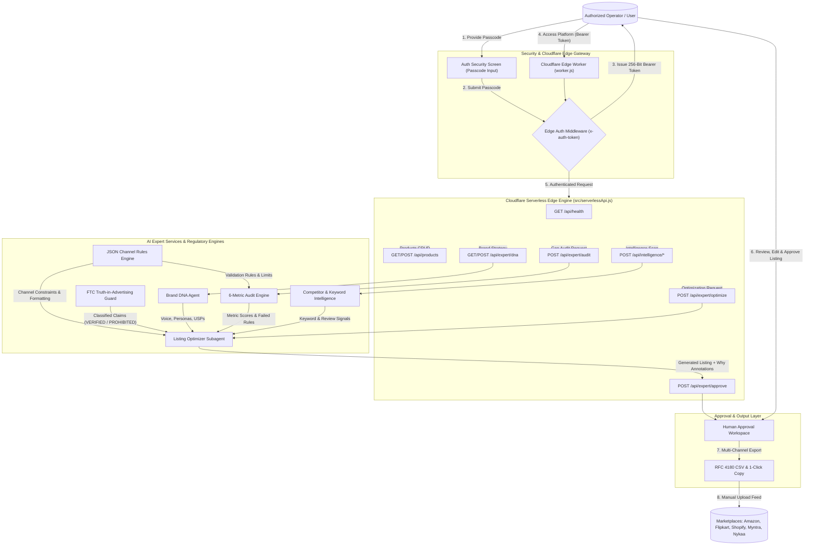

# OCT Catalog — Multi-Channel E-Commerce Listing Intelligence Platform

An enterprise-grade multi-channel listing audit, brand DNA optimization, regulatory claim safety, and competitor intelligence platform deployed to **Cloudflare Serverless Workers Edge** with **Authorized Access Protection**.

---

## 📊 Complete Platform Data Flow Diagram (DFD)



---

## 🌟 Live Serverless Deployments & Repositories

- **Cloudflare Worker Application**: [https://oct-catalog.streetwokco.workers.dev/](https://oct-catalog.streetwokco.workers.dev/)
- **Cloudflare Worker Edge API**: [https://oct-catalog.streetwokco.workers.dev/api/health](https://oct-catalog.streetwokco.workers.dev/api/health)
- **GitHub Code Repository**: [https://github.com/streetwokco-a11y/oct-catalog](https://github.com/streetwokco-a11y/oct-catalog)

---

## 🚀 Key Modules & Capabilities

### 1. 🔒 Authorized Access Security Screen
- **Passcode Authentication**: Protects platform APIs with master passcode authentication (`MarketPlus2024!`).
- **256-Bit Bearer Token**: Requires `Authorization: Bearer <token>` or `x-auth-token` header for all requests.
- **Session Locking**: Allows instant session locking from the top navigation header.

### 2. 📊 6-Metric Digital Shelf Gap Audit
- **Zero-Login Auditing**: Evaluates listings without requiring marketplace API login credentials.
- **Metrics Covered**:
  1. Title SEO & Keyword Density
  2. Bullet Point Depth & Persuasiveness
  3. Image Asset Resolution & Fill Percentage
  4. Dynamic 249-Byte Search Term UTF-8 Calculation
  5. FTC Claim Safety Verification
  6. Channel JSON Schema Compliance

### 3. 🛡️ FTC Truth-in-Advertising Claim Guard
- Classifies claims into `VERIFIED`, `SUPPORTED`, `NEEDS_HUMAN_VERIFICATION`, or `PROHIBITED`.
- Prevents unsubstantiated health, medical, or environmental claims.

### 4. ⚡ 5-Marketplace Rules Engine
- Enforces versioned channel rule configs for **Amazon**, **Flipkart**, **Shopify**, **Myntra**, and **Nykaa**.
- Outputs traceable audit explanations (`Score → Failed Rule ID → Recommendation`).

### 5. 🎯 Competitor Benchmarking & Review Intelligence
- Side-by-side gap comparison against competitor ASINs/FSNs.
- Category search volume & missing keyword opportunity calculator.
- Customer review sentiment parser and objection-busting bullet point generator.

---

## 🛠️ Local Development & Deployment Commands

```bash
# Clone Repository
git clone https://github.com/streetwokco-a11y/oct-catalog.git
cd oct-catalog

# Install Dependencies
npm install

# Run Local Backend Server (Port 5000)
node server.js

# Run Frontend Dev Server (Port 3000 / 3002)
npm run dev

# Build Static Production Bundle
npm run build

# Deploy to Cloudflare Workers (Serverless Edge)
npm run deploy
```

---

## 📄 License
Internal Enterprise License © 2026 OCT Catalog Team. All Rights Reserved.
