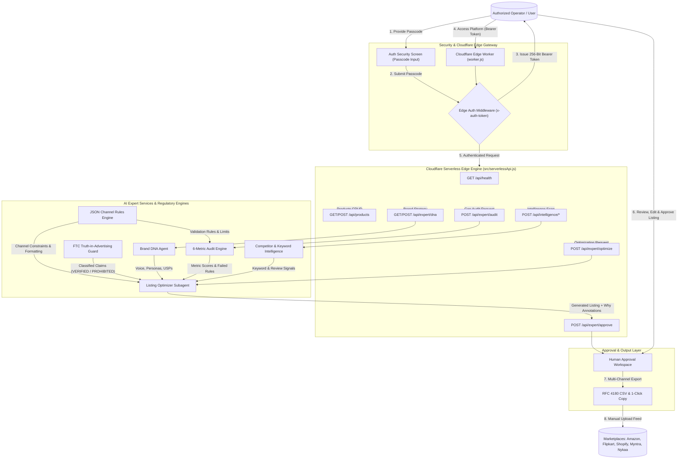

# System Architecture & DFD Specification (`architecture.md`)

This document presents the **System Architecture**, **Multi-Agent Swarm Framework**, **Regulatory Guard Systems**, and **Data Flow Diagrams (DFD)** for the **OCT Catalog Platform**.

---

## 📊 Complete Platform Data Flow Diagram (DFD)

---

## 🤖 AI Subagent Swarm Architecture

The platform utilizes a **Micro-Subagent Swarm** design where specialized AI agents cooperate to audit, optimize, and validate product listings:

### 1. Brand DNA Agent (`connectors/expertAgents.js`)
- Maintains brand strategy, voice, tone, buyer personas, USPs, and visual attributes.
- Deeply merges custom DNA profiles with default fallbacks.

### 2. 6-Metric Gap Audit Engine (`connectors/expertAgents.js` & `connectors/ruleEngine.js`)
- Performs zero-login listing analysis against:
  1. Title SEO & Keyword Front-Loading
  2. Bullet Point Depth & Persuasiveness
  3. Image Asset Resolution & Fill Percentage
  4. Dynamic 249-Byte Search Term UTF-8 Calculation
  5. FTC Truth-in-Advertising Claim Safety
  6. Channel JSON Schema Contract Compliance

### 3. Single-Channel Specialist Swarm (`connectors/channelAgents.js`)
- Dedicated channel agents for **Amazon**, **Flipkart**, **Shopify**, **Myntra**, and **Nykaa**.
- Applies channel-specific title formulas, bullet structure constraints, image requirements, and deduplicated search terms.

### 4. FTC Claim Guard Engine (`connectors/claimGuard.js`)
- Classifies claims into `VERIFIED`, `SUPPORTED`, `NEEDS_HUMAN_VERIFICATION`, or `PROHIBITED`.
- Prevents unsubstantiated health, medical, or environmental claims from reaching production listings.

### 5. Competitor & Keyword Intelligence Engine (`connectors/competitorEngine.js`)
- Benchmarks catalog listings against competitor ASINs/FSNs.
- Extracts high-volume long-tail keywords and parses customer review sentiment to address buyer friction points.

---

## 📄 Output & Feed Formatting

- **Human Approval Workspace ([HumanApprovalWorkspace.jsx](file:///home/rockyy/oct%20catalog/catalog/src/components/HumanApprovalWorkspace.jsx))**: Provides side-by-side comparison, "Why" change annotations, and claim risk badges.
- **RFC 4180 CSV Exporter**: Uses `escapeCsvCell(str)` cell sanitization to produce error-free CSV files for direct upload to Amazon Seller Central, Flipkart Seller Hub, Shopify Admin, Myntra Partner Portal, or Nykaa Seller Portal.
