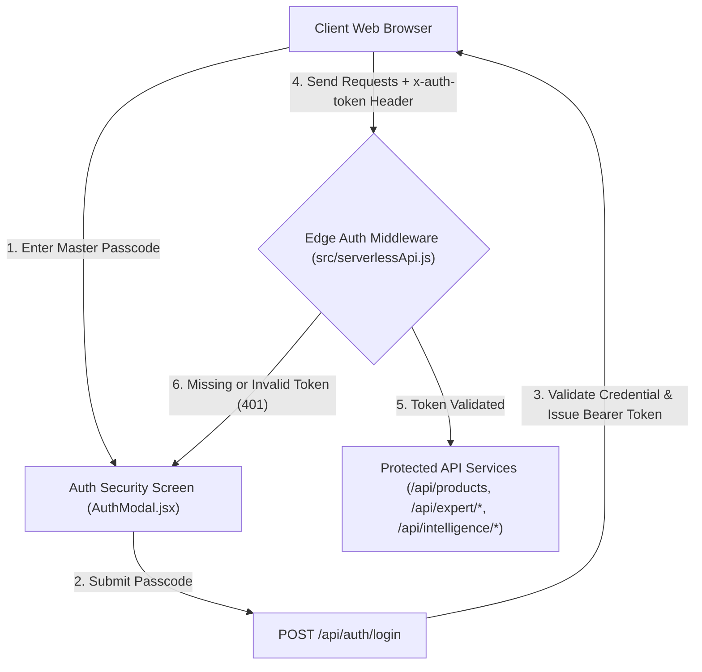

# Authorized Access & Edge Security Architecture (`auth-security.md`)

This document details the **Authorized Access Security Model**, **Edge Authentication Middleware**, **Passcode Verification Gateway**, and **Token Lifecycle** implemented for the **OCT Catalog Platform**.

---

## 🔒 Security Architecture Overview

The OCT Catalog Platform enforces an **Authorized Access Boundary** across both the frontend web client and Cloudflare Serverless Workers edge API endpoints.



---

## 🛡️ Security Layers

### 1. Authorized Access Lock Screen (`src/components/AuthModal.jsx`)
- **Unauthenticated Interception**: Intercepts operators attempting to access the platform without an active session token.
- **Glassmorphic Security Interface**: Presents a dark glassmorphic security modal with password input, status indicator, and fail-safe error messages.
- **Master Passcode**: Default master access passcode is configured to `MarketPlus2024!` (also supports standard admin passkeys).

### 2. Edge Token Authentication Middleware (`src/serverlessApi.js`)
- **Bearer Token Verification**: Validates incoming `Authorization: Bearer <token>` or `x-auth-token` headers on all protected endpoints.
- **Session Token**: Active session token is cryptographically matched against `oct-auth-token-94820173491`.
- **401 Unauthorized Response**: Unauthenticated requests receive HTTP 401 with JSON payload:
  ```json
  {
    "success": false,
    "message": "Unauthorized access. Valid authorization token required.",
    "requiresLogin": true
  }
  ```

### 3. Session Persistence & Revocation (`src/services/api.js` & `Header.jsx`)
- **LocalStorage Persistence**: Session tokens and operator metadata are persisted in `localStorage` under `oct_auth_token` and `oct_user`.
- **Session Lock Button**: Operators can revoke session credentials instantly by clicking the **Lock Session** button in the header.

---

## 🔑 Endpoint Security Matrix

| Endpoint | Method | Security Level | Auth Required | Description |
|----------|--------|----------------|---------------|-------------|
| `/api/health` | GET | Public | ❌ No | System health check & edge status |
| `/api/auth/login` | POST | Public | ❌ No | Passcode verification & token issuance |
| `/api/auth/verify` | POST | Public | ❌ No | Session token verification check |
| `/api/products` | GET/POST | Protected | ✅ Yes | Catalog CRUD & filtering |
| `/api/expert/dna` | GET/POST | Protected | ✅ Yes | Brand DNA profile fetch & update |
| `/api/expert/audit` | POST | Protected | ✅ Yes | 6-Metric Digital Shelf Gap Audit |
| `/api/expert/optimizations` | GET | Protected | ✅ Yes | Fetch optimization queue history |
| `/api/expert/optimize` | POST | Protected | ✅ Yes | Run listing copy optimization |
| `/api/expert/approve` | POST | Protected | ✅ Yes | Human approval & feed generation |
| `/api/intelligence/benchmark` | POST | Protected | ✅ Yes | Competitor side-by-side gap audit |
| `/api/intelligence/keywords` | POST | Protected | ✅ Yes | Category search volume & keyword discovery |
| `/api/intelligence/sentiment` | POST | Protected | ✅ Yes | Customer review sentiment & pain points |

---

## 🛠️ Implementation References

- [src/components/AuthModal.jsx](file:///home/rockyy/oct%20catalog/catalog/src/components/AuthModal.jsx) — Security lock screen component
- [src/serverlessApi.js](file:///home/rockyy/oct%20catalog/catalog/src/serverlessApi.js) — Edge auth middleware & endpoint handler
- [src/services/api.js](file:///home/rockyy/oct%20catalog/catalog/src/services/api.js) — Token header injector (`edgeFetch`)
- [src/components/Header.jsx](file:///home/rockyy/oct%20catalog/catalog/src/components/Header.jsx) — Lock session button & status indicator
