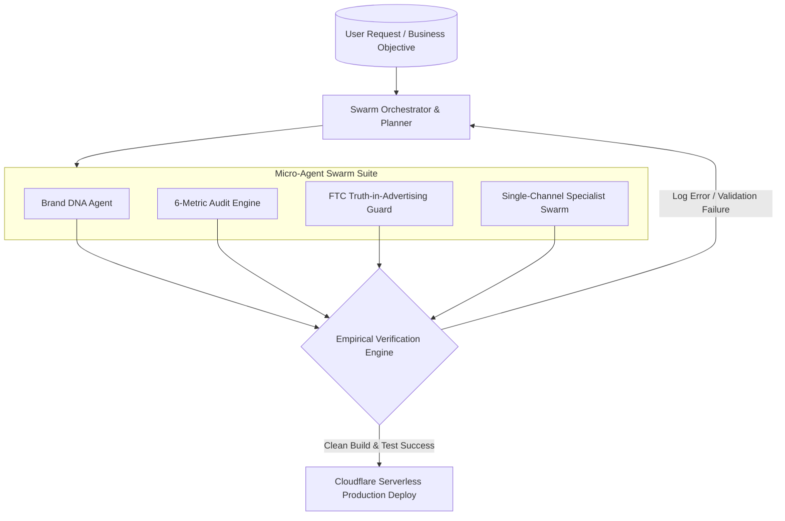

# Autonomous Beast Engineering Workflow (`autonomous-beast-engineering-workflow.md`)

This document defines the **Autonomous Beast Engineering Workflow**, **Multi-Agent Swarm Orchestration**, **Self-Healing Execution Loops**, and **Empirical Verification Rules** powering the **OCT Catalog Platform**.

---

## ⚡ Autonomous Workflow Overview

The **Autonomous Beast Engineering Workflow** is designed for high-throughput, self-healing, and evidence-backed agentic development. Rather than executing manual step-by-step tasks, autonomous AI agents operate in specialized swarms to analyze requirements, audit listings, generate regulatory-safe copy, and deploy serverless releases.



---

## 🤖 Swarm Micro-Agent Roles

The platform deploys dedicated agent employees, each responsible for a single domain contract:

| Agent Name | Primary File | Responsibility |
|------------|--------------|----------------|
| **Brand DNA Agent** | `connectors/expertAgents.js` | Maintains brand voice, tone, buyer personas, USPs, and visual attributes. Performs deep recursive merging for custom profiles. |
| **6-Metric Audit Engine** | `connectors/expertAgents.js` | Audits listings across Title SEO, Bullet Persuasiveness, Image Resolution, 249-Byte Search Terms, FTC Claim Safety, and Schema Rules. |
| **FTC Claim Guard Engine** | `connectors/claimGuard.js` | Classifies listing copy into `VERIFIED`, `SUPPORTED`, `NEEDS_HUMAN_VERIFICATION`, or `PROHIBITED`. Prevents unsubstantiated health, medical, or environmental claims. |
| **Amazon Channel Agent** | `connectors/channelAgents.js` | Enforces 200-char title limit, front-loaded brand names, and 249-byte deduplicated search terms without commas. |
| **Flipkart Channel Agent** | `connectors/channelAgents.js` | Enforces Flipkart Title Formula `[Brand] [Name] ([Variant], [Color])` and MRP selling price sanity checks. |
| **Nykaa Channel Agent** | `connectors/channelAgents.js` | Audits beauty/wellness shade specifications, ingredient transparency, and dermatological test claims. |
| **Myntra Channel Agent** | `connectors/channelAgents.js` | Enforces apparel size matrix coverage, fabric composition disclosure, and wash-care tags. |
| **Shopify Channel Agent** | `connectors/channelAgents.js` | Validates SEO meta titles, URL handles, product tags, and unstructured metafield formatting. |

---

## 🔁 Self-Healing Loop & Empirical Guidelines

> [!IMPORTANT]
> **No Superficial Symptom Patches**  
> When a test, build, or endpoint fails, agents must trace the root cause directly from un-truncated empirical logs rather than masking errors with fallback try/catch blocks or dummy data.

### Self-Healing Lifecycle:
1. **Empirical Log Fetching**: Inspect un-truncated build or runtime logs upon any failure.
2. **Root Cause Diagnosis**: Trace failing imports, missing symbols, or out-of-bounds byte lengths.
3. **Targeted Code Refactoring**: Apply exact edits to source code files.
4. **Automated Re-Verification**: Execute `npm run build` and endpoint checks (`/api/health`) to gather concrete proof of clean execution before declaring success.

---

## 🛠️ Verification Commands

```bash
# 1. Run Static Code Analysis & Build Verification
npm run build

# 2. Test Edge Health Endpoint
curl -s https://oct-catalog.streetwokco.workers.dev/api/health
```
