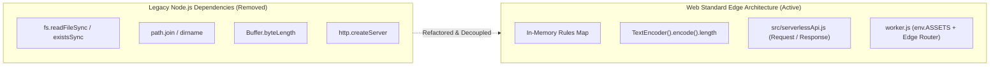

# ESM & Edge Runtime Isolation Architecture (`esm-edge-separation.md`)

This document describes the **ESM & Edge Runtime Isolation Architecture**, **Zero Node Dependency Refactoring**, and **Web Standard API Abstraction** used in the **OCT Catalog Platform**.

---

## 🌐 Edge Isolation Overview

To deploy seamlessly to **Cloudflare Workers** V8 isolate runtime, the entire backend API and subagent engine were refactored to achieve **100% ESM & Web Standard Compliance**. Legacy Node.js runtime bindings (`fs`, `path`, `http`, `Buffer`) were removed or replaced with cross-platform Web Standard equivalents.



---

## 🔄 API & Module Mapping Matrix

| Feature | Legacy Node Implementation | Web Standard Edge Implementation | Advantage |
|---------|---------------------------|----------------------------------|-----------|
| **HTTP Server & Routing** | `http.createServer((req, res) => ...)` | `handleServerlessApiRequest(request)` returning standard `Response` | Operates natively inside V8 isolates & web browsers |
| **Channel Rules Loading** | `fs.readFileSync(path.join(...))` | In-memory `CHANNEL_RULES_MAP` object in `ruleEngine.js` | Zero filesystem I/O latency; instant edge execution |
| **Search Term Byte Length** | `Buffer.byteLength(str, 'utf8')` | `new TextEncoder().encode(str).length` | Prevents `Buffer is not defined` ReferenceErrors |
| **Static Asset Delivery** | `fs.createReadStream` static server | `env.ASSETS.fetch(request)` binding | High-speed global Cloudflare CDN distribution |

---

## 🛠️ Code Comparison Examples

### 1. UTF-8 Byte Length Calculation

> [!NOTE]
> **Cross-Platform `getByteLength` Helper (`connectors/channelAgents.js`)**
> ```javascript
> function getByteLength(str) {
>   if (!str) return 0;
>   if (typeof Buffer !== 'undefined') {
>     return Buffer.byteLength(str, 'utf8');
>   }
>   return new TextEncoder().encode(str).length;
> }
> ```

### 2. Edge API Response Abstraction

> [!TIP]
> **Web Standard Response Helper (`src/serverlessApi.js`)**
> ```javascript
> function jsonResponse(data, status = 200) {
>   return new Response(JSON.stringify(data), {
>     status,
>     headers: {
>       'Content-Type': 'application/json',
>       'Access-Control-Allow-Origin': '*',
>       'Access-Control-Allow-Methods': 'GET, POST, PUT, DELETE, OPTIONS',
>       'Access-Control-Allow-Headers': 'Content-Type, Authorization, x-auth-token'
>     }
>   });
> }
> ```

---

## 📄 Reference Implementation Files

- [src/serverlessApi.js](file:///home/rockyy/oct%20catalog/catalog/src/serverlessApi.js) — Web Standard Edge API Router
- [worker.js](file:///home/rockyy/oct%20catalog/catalog/worker.js) — Cloudflare Worker entrypoint with asset binding
- [connectors/ruleEngine.js](file:///home/rockyy/oct%20catalog/catalog/connectors/ruleEngine.js) — Pure ESM channel rules engine
- [connectors/channelAgents.js](file:///home/rockyy/oct%20catalog/catalog/connectors/channelAgents.js) — Micro-agent channel employees with `TextEncoder` byte validation
