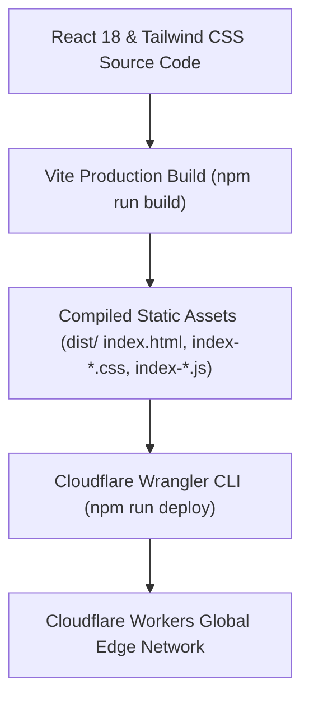

# Production Deployment & Monitoring Guide (`production.md`)

This document presents the **Production Deployment Guide**, **Cloudflare Workers Deployment Pipeline**, **Vite Build System**, and **Edge Monitoring Protocols** for the **OCT Catalog Platform**.

---

## 🚀 Production Environment Overview

- **Live Application URL**: [https://oct-catalog.streetwokco.workers.dev/](https://oct-catalog.streetwokco.workers.dev/)
- **Live Edge API Health Endpoint**: [https://oct-catalog.streetwokco.workers.dev/api/health](https://oct-catalog.streetwokco.workers.dev/api/health)
- **GitHub Repository**: [https://github.com/streetwokco-a11y/oct-catalog](https://github.com/streetwokco-a11y/oct-catalog)
- **Cloudflare Account ID**: `3d2e28d9f108c3e22f5872c71348c0a7`

---

## ⚡ Deployment Pipeline Architecture



---

## 🛠️ Step-by-Step Production Release Workflow

### Step 1: Install Dependencies
```bash
cd "/home/rockyy/oct catalog/catalog"
npm install
```

### Step 2: Build Static Assets
Compiles React components, bundle chunks, and local Tailwind CSS JIT styles into `dist/`:
```bash
npm run build
```

### Step 3: Deploy to Cloudflare Workers
Uploads static assets via Cloudflare Worker Assets binding (`env.ASSETS`) and deploys the Edge API router:
```bash
npx wrangler deploy
```

### Step 4: Commit & Push to GitHub
```bash
git add .
git commit -m "Production Release: OCT Catalog Serverless Update"
git push origin main
```

---

## 📊 Live Monitoring & Health Diagnostics

The platform exposes an automated health diagnostic endpoint at `/api/health`.

### Verification Command:
```bash
curl -s https://oct-catalog.streetwokco.workers.dev/api/health
```

### Expected JSON Response:
```json
{
  "status": "UP",
  "service": "OCT Catalog Cloudflare Serverless Edge API",
  "security": "Authorized Access Active",
  "timestamp": "2026-10-08T09:55:00.000Z"
}
```

---

## 🛡️ Rollback Protocols

In the event of an edge issue, Wrangler allows instant version rollbacks:
```bash
# List Cloudflare Worker Deployment History
npx wrangler deployments list

# Rollback to Previous Deployment Version
npx wrangler rollback <VERSION_ID>
```
