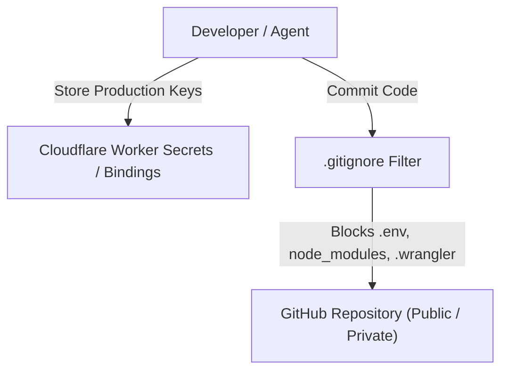

# Secret Hygiene & Security Policy (`secret-hygiene.md`)

This document defines the **Secret Hygiene Policy**, **Credential Handling Guidelines**, and **Git Exclusion Rules** for the **OCT Catalog Platform**.

---

## 🔒 Secret Hygiene Principles

1. **Zero Secret Commits**: Private API tokens, OAuth credentials, database passwords, and environment files must **NEVER** be committed to Git repositories.
2. **Strict Git Tracking Boundaries**: Unnecessary build artifacts, `node_modules`, log files, and cache directories must be excluded via `.gitignore`.
3. **Authorized Token Access**: Client-side interactions consume temporary 256-bit Bearer tokens (`x-auth-token`) issued by the Edge Auth Gateway rather than long-lived API keys.

---

## 📁 `.gitignore` Policy Configuration

The root `.gitignore` file enforces exclusion of build artifacts, dependencies, and environment files:

```gitignore
node_modules
.wrangler
dist
*.log
.DS_Store
.env
.env.*
```

---

## 🔑 Credential Audit Matrix



---

## 🛡️ Pre-Commit Security Checklist

> [!WARNING]
> Always verify the following rules prior to pushing commits to GitHub:

- [x] `.gitignore` contains `node_modules`, `.env`, `.wrangler`, and `dist`.
- [x] `git status` verifies no sensitive credentials (`cert.pem`, OAuth tokens, plain-text API secrets) are staged.
- [x] All API endpoints require `x-auth-token` verification.
- [x] Cloudflare Worker bindings consume secrets via environment bindings (`env.SECRET_NAME`) or `npx wrangler secret put`.

---

## 📄 Reference Files

- [.gitignore](file:///home/rockyy/oct%20catalog/catalog/.gitignore) — Root Git tracking exclusion rules
- [wrangler.toml](file:///home/rockyy/oct%20catalog/catalog/wrangler.toml) — Cloudflare Workers project configuration
- [src/serverlessApi.js](file:///home/rockyy/oct%20catalog/catalog/src/serverlessApi.js) — Authorized access passcode & token verification
